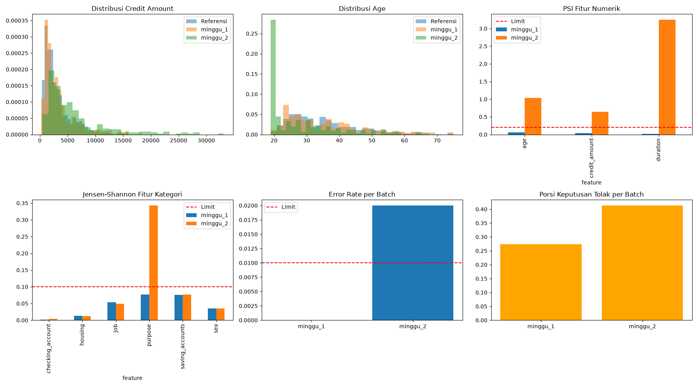

# Tugas Pertemuan 26–28 — Sistem Kredit Mini

Nama: David (tugas-26-28-david)

Tiga bagian dalam satu repo:

| Bagian | Pertemuan | Isi |
| --- | --- | --- |
| A | 26 · RAG Engineering | Asisten tanya-jawab kebijakan kredit (8 dokumen, hybrid + rerank, sitasi, fallback) |
| B | 27 · MLOps | Model credit risk (German Credit): MLflow tracking, versi data, quality gate, registry, promote |
| C | 28 · Monitoring | Serving ber-log, simulasi 2 minggu, drift KS/PSI/JS, alert, dashboard, SOP |

## Setup

```bash
python -m venv .venv
# Windows: .venv\Scripts\activate    |   Mac/Linux: source .venv/bin/activate
pip install -r requirements.txt
```

Unduh dataset ke `data/credit/german_credit_data.csv` (lihat `data/credit/README.md`).

## Menjalankan

```bash
python src/rag_eval.py                         # Bagian A: evaluasi 4 mode RAG
python src/pipeline.py --reason "commit baru"  # Bagian B: test -> train -> gate -> register -> promote
python src/quality_gate.py                     # Bagian B: cek ulang model terpilih (exit 0 / 1)
python src/simulate.py                         # Bagian C: trafik minggu_1 dan minggu_2
python src/monitor.py                          # Bagian C: drift, alert, dashboard, laporan
mlflow ui --backend-store-uri sqlite:///mlflow.db   # buka http://127.0.0.1:5000
```

## Hasil Bagian A — RAG

| mode | hit_at_3 | citation_acc | fallback_acc | avg_latency_ms |
| --- | --- | --- | --- | --- |
| dense | 0.9167 | 0.8333 | 1.0000 | 7.32 |
| bm25 | 0.8333 | 0.5833 | 1.0000 | 7.24 |
| hybrid | 0.9167 | 0.8333 | 1.0000 | 7.72 |
| hybrid_rerank | **1.0000** | **1.0000** | **1.0000** | **19.60** |

- **Ambang fallback yang dipakai dan alasannya:** 0.35. Berdasarkan hasil evaluasi detail, skor tertinggi pertanyaan di luar topik sangat rendah (~0.18), sedangkan pertanyaan dalam topik memiliki skor di atas 0.4. Nilai 0.35 adalah titik tengah yang aman untuk menolak *out-of-context* tanpa memotong pertanyaan valid.
- **Mode yang dipilih dan alasannya:** `hybrid_rerank`. Meskipun latency-nya paling tinggi (~19.6 ms dibandingkan ~7 ms pada mode dense), mode ini memberikan hasil yang sempurna (Hit@3 = 100%, Citation Acc = 100%). Dalam domain perbankan, akurasi hukum/sitasi jauh lebih penting daripada selisih 12 milidetik. 

## Hasil Bagian B — MLOps


| model | roc_auc | recall_bad | precision_bad | f1_bad | quality gate |
| --- | --- | --- | --- | --- | --- |
| logreg | 0.7592 | 0.7222 | 0.5000 | 0.5909 | Lulus |
| random_forest | 0.7629 | 0.7222 | 0.4887 | 0.5830 | Lulus |
| gradient_boosting | 0.7670 | 0.3556 | 0.5517 | 0.4324 | **Gagal** |

- **data_version:** `42be3b82a2e5`
- **Model yang menjadi champion dan alasannya:** `random_forest`. Meskipun `gradient_boosting` memiliki AUC tertinggi (0.7670), model tersebut gagal Quality Gate karena *Recall bad* sangat rendah (0.3556 < 0.50). Artinya, model itu meloloskan terlalu banyak nasabah berisiko. `random_forest` dipilih karena memiliki AUC tertinggi (0.7629) di antara model yang lulus gate, dengan Recall yang baik (0.7222).
- **Bukti quality gate bisa gagal:** Saat simulasi `GATES` diubah menjadi `roc_auc: 0.95`, pipeline menghasilkan output:
  `❌ Tidak ada model yang lulus Quality Gate. Pipeline dihentikan.`
  *(Dan pada run kedua, pipeline mencetak: `⏸️ Model baru tidak lebih baik. Tetap menggunakan champion lama (v1).`)*

## Hasil Bagian C — Monitoring



- **Metrik operasional per batch:** 
  - `minggu_1`: error_rate=0%, p95_latency=20.91 ms, throughput=49.73 rps.
  - `minggu_2`: error_rate=2%, p95_latency=19.88 ms, throughput=50.58 rps.
- **Fitur yang drift di minggu_2 dan angkanya:** 
  - Numerik: `age` (PSI = 1.03), `credit_amount` (PSI = 0.64), `duration` (PSI = 3.24).
  - Kategori: `purpose` (JS distance = 0.22).
- **AUC minggu_1 vs minggu_2, dan apa artinya:** AUC turun dari `0.7629` (minggu 1) menjadi `0.7387` (minggu 2). Model belum turun di bawah ambang kritis 0.70, namun penurunan ini menunjukkan bahwa pergeseran populasi (*drift*) mulai mempengaruhi performa model.
- **Alert yang menyala:** 
  - `minggu_2: error rate 2.0% > 1.0%`
  - `minggu_2: drift pada age, credit_amount, duration, purpose`
- **Keputusan dan alasannya:** **Tidak retrain sekarang**. Kami akan memperbaiki validasi input untuk menekan *error rate* kembali ke 0%. Meskipun terjadi *drift*, model masih cukup akurat (AUC > 0.70). Retrain baru akan dilakukan jika kita sudah memiliki data historis dengan label yang sudah matang dari populasi baru tersebut (misal 3-6 bulan ke depan), agar model bisa belajar dari pola yang benar.

## Limitation dan eksperimen berikutnya

1. **Latency Rerank:** Mode `hybrid_rerank` memakan waktu ~19.6 ms, 3x lebih lambat dari dense. Pada skala enterprise, ini perlu dioptimasi (misal dengan *batching* atau menggunakan model cross-encoder yang lebih ringan).
2. **Simulasi Drift:** Data minggu_2 dibuat secara artifisial dengan menggeser nilai *age* dan *credit_amount*. Pada dunia nyata, drift terjadi secara bertahap dan lebih kompleks.
3. **Eksperimen berikutnya:** Mengimplementasikan **FastAPI** untuk *serving* agar siap *production*, dan mengintegrasikan **Evidently AI** untuk membuat laporan *drift* otomatis secara *real-time*.